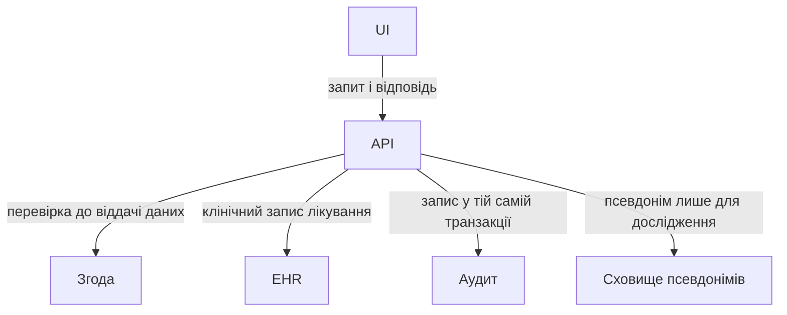

# Контур компонентів

Задача PIS-19. Одна схема і рівно ті частини, які названо в описі: EHR, API, згода, аудит, сховище псевдонімів, UI.

Це контур вимог, не діаграма розгортання. Component і Deployment для локального прототипу (backend, frontend, PostgreSQL) лишаються за PIS-27. PostgreSQL на схемі немає окремим блоком: EHR, згода, аудит і сховище псевдонімів — логічні компоненти, які PIS-30 і PIS-31 кладуть у схеми `clinical` і `vault`.

UI не з’єднаний з EHR, згодою, аудитом і сховищем псевдонімів. Будь-яке читання йде через API.

API читає EHR для лікування лише після перевірки згоди. Для дослідження API бере псевдонім зі сховища і не віддає прямі ідентифікатори. Дослідник до сховища не ходить: ключ HMAC не читає жодна роль (A-17 у PIS-15).

Ребро аудиту означає fail-closed з PIS-17. Немає записаного рядка журналу — API не повертає ні клінічний Bundle, ні дослідницький CSV.
