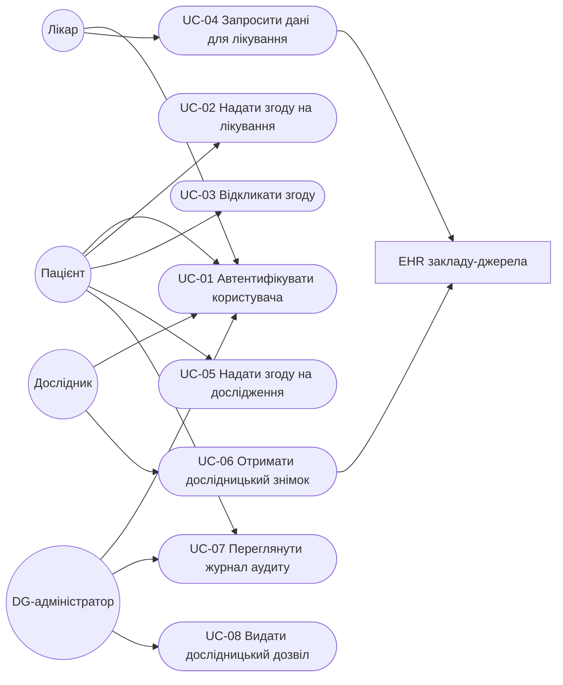

# Платформа керованого обміну медичними даними між закладами

**Формалізація етапу 1 і чернетка вимог етапу 2**

| | |
|---|---|
| Дисципліна | Проєктування інформаційних систем |
| Джерело рамок | методичні вказівки 2026 «Data Governance by Design» (Дорошенко А. В.) |
| Тема | Платформа керованого обміну медичними даними між закладами (за мотивами EHDS) |
| Статус теми | погоджено з викладачем |
| Дата фіксації | 4 листопада 2026 |
| Статус документа | етап 1 перенесено в репозиторій 23.11.2026; етап 2 лишається чернеткою до вичитки команди |

Орієнтир предметної області — Регламент (EU) 2025/327 про Європейський простір даних про здоров’я (EHDS). Для прототипу команди він задає поділ на первинне і вторинне використання, а не юридичний режим України. Обов’язкові норми прототипу — Закон України «Про захист персональних даних» і вимога курсів: обмін даними є керованим.

## Перенесення 23.11.2026

Цей текст — формалізація від 4 листопада 2026, перенесена в репозиторій задачею PIS-12. На 23 листопада 2026 проєкт Jira PIS і GitHub `pis-ehds-exchange` уже існують, гілка `main` захищена. Розділ 10 нижче лишається записом стану на 4 листопада, не поточною інструкцією.

Рішення D1–D15 цим перенесенням не змінювались. Дві пізніші фіксації лежать в інших pull request. Цей файл їх не скасовує:

- PIS-17 задає пороги локального прототипу 500 мс для лікування і 2 с для дослідницького знімка і не обирає фреймворк інтерфейсу. D8 як і раніше записує React (Vite) як рішення етапу 1.
- PIS-15 A-07 в аварійному доступі віддає також лабораторні спостереження. UC-04 AC2 лабораторний архів в аварійний шлях не пускає. Це відкрите питання вичитки PIS-13, не нова домовленість.

D15 фіксує спринт 1 як 9–20 листопада 2026. Дату спринту на дошці це перенесення не змінює.

---

## 1. Рішення, які команда більше не тримає відкритими

Повний журнал — у розділі 9. Коротко:

- Обмін має два контури: лікування (ідентифіковані дані, запит лікаря) і дослідження (псевдонімізований разовий знімок).
- Згода пацієнта обов’язкова в обох контурах. Єдиний виняток — аварійний доступ лікаря з окремим записом аудиту.
- Методологія — адаптований Scrum, спринт два тижні.
- Дошка — Jira Software (team-managed Scrum), ключ проєкту `PIS`.
- Код — Git, репозиторій `pis-ehds-exchange`, адміністратор Учасник 1.
- Стек прототипу — Python (FastAPI), PostgreSQL, React (Vite).
- У репозиторії лише синтетичні пацієнти. Інтеграції з НСЗУ, КЕП і промислового хостингу в прототипі немає.

---

## 2. Сценарій обміну даними

Платформа — вузол керованого обміну між закладами. Вона не замінює внутрішню медичну інформаційну систему закладу. Джерело клінічного запису лишається в закладі, де пацієнта вже лікували. Платформа перевіряє роль, згоду, якість і лише після цього віддає дані споживачу, а кожне рішення пише в журнал аудиту.

Навчальний контур із трьох організацій:

| Учасник | Роль в обміні | Ідентифікатор у прототипі |
|---|---|---|
| Міська лікарня №1 | заклад-джерело, постачальник запису | `org-source` |
| Обласна клінічна лікарня | заклад-отримувач для лікування | `org-consumer` |
| Університетська дослідницька лабораторія | споживач вторинного використання | `org-research` |

Електронний запис закладу-джерела (EHR) у прототипі імітований: це таблиці PostgreSQL і заздалегідь завантажений FHIR Bundle, а не живе підключення до лікарняної системи.

### 2.1. Первинне використання (лікування)

**Постачальник.** EHR закладу-джерела. Платформа забирає з нього набір лише після успішної перевірки прав.

**Споживач.** Лікар закладу-отримувача, в якого пацієнт перебуває в поточному епізоді лікування.

**Дані.** Ідентифікований мінімальний клінічний набір:

- пацієнт (псевдонімний навчальний ідентифікатор, стать, рік народження в джерелі; у відповіді лікарю — також ім’я синтетичного пацієнта);
- алергії;
- стани і діагнози;
- медикаменти;
- лабораторні спостереження.

**Формат.** HL7 FHIR R4, JSON, один Bundle типу `collection`. Ресурси прототипу: `Patient`, `AllergyIntolerance`, `Condition`, `MedicationStatement`, `Observation`. Системи кодів: алергії — локальний словник `https://pis.local/allergy`; діагнози — ICD-10; медикаменти — ATC; лабораторії — LOINC.

**Періодичність.** За запитом лікаря. Регулярного вивантаження ідентифікованих даних немає.

**Обмеження доступу.** Одночасно мають виконуватися всі умови:

- роль «лікар» і обліковий запис належить закладу-отримувачу;
- у прототипі ввімкнено прапорець «пацієнт у поточному епізоді цього закладу»;
- мета запиту — `treatment`;
- чинна згода пацієнта покриває кожну запитану категорію;
- віддається лише запитана категорія, не весь запис закладу.

**Обмеження якості.** Набір без ідентифікатора пацієнта, з невідомою системою коду або з датою в майбутньому не передається. Дані, старші за 365 діб, передаються з позначкою `quality=stale`: для лікування приховувати давню алергію небезпечніше, ніж показати її з попередженням.

**Простежуваність.** Кожен дозвіл, відмова і відхилення через якість дає запис журналу: хто, з якого закладу, коли, щодо якого пацієнта, які типи ресурсів, ідентифікатор згоди, результат, correlation id. Лікар бачить correlation id на екрані підтвердження.

**Аварійний доступ.** Якщо згоди на лікування немає, лікар може відкрити лише алергії, стани і медикаменти, вказавши текстову причину. Лабораторний архів у цей шлях не входить. Подія позначається `break_glass`, пацієнт бачить сповіщення у своєму журналі, DG-адміністратор бачить подію окремо від звичайних доступів. Це єдиний виняток із обов’язкової згоди.

**Слід у закладі-отримувачі.** Отриманий Bundle зберігається як пакет обміну 30 діб, далі лікарю недоступний. Запис аудиту лишається. Платформа не стає другою повною карткою пацієнта.

### 2.2. Вторинне використання (дослідження)

**Постачальник.** Той самий заклад-джерело. Точкою видачі є платформа: дослідник не звертається до EHR напряму і не бачить ідентифікованого Bundle.

**Споживач.** Дослідник університетської лабораторії, названий у чинному дозволі.

**Дані.** Псевдонімізований когортний знімок: вікова група (5 років), стать, коди станів, медикаментів і спостережень, зміщені дати. Ім’я, контакт, адреса, точна дата народження, ідентифікатор закладу і вільний текст до знімка не потрапляють.

**Формат.** Канонічний обмін — FHIR R4 JSON із проєктним псевдонімом у `Patient.identifier`. Похідний файл для завантаження — CSV тієї самої вибірки. CSV не є другим джерелом правди.

**Періодичність.** Один знімок на один дозвіл. Живої стрічки нових пацієнтів немає. Строк дозволу — не довше 90 діб. Повторний знімок потребує нового дозволу.

**Обмеження доступу.** Одночасно:

- роль «дослідник»;
- дозвіл DG-адміністратора в статусі `approved`, у своєму вікні дат, із тими самими категоріями і фільтром когорти;
- у знімок входять лише пацієнти з окремою чинною згодою на дослідження;
- якщо після фільтрів у групі менше ніж 5 пацієнтів, знімок не видається.

**Простежуваність.** Журнал фіксує дослідника, дозвіл, ідентифікатор знімка, категорії, кількість рядків, час і факт завантаження CSV. Таблиця відповідності «псевдонім → пацієнт» лежить в окремій схемі БД. Її читає лише DG-адміністратор, і кожне таке читання теж пишеться в журнал. Дослідник цієї таблиці не отримує.

Псевдонімізовані дані за наявності таблиці відповідності лишаються персональними. Тому вторинне використання теж вимагає згоди. У самому EHDS для частини вторинного використання діє право відмови. Команда свідомо ставить суворішу умову opt-in: так прототип збігається із Законом України «Про захист персональних даних» і з уже прийнятим рішенням, що згода обов’язкова.

### 2.3. Спільні правила контролю

Порядок перевірки однаковий для обох контурів. Будь-який збій на кроці 1–5 зупиняє видачу.

1. Користувач автентифікований, роль активна.
2. Мета запиту дозволена цій ролі.
3. Для лікування є згода на категорію або аварійний доступ. Для дослідження є згода пацієнта і чинний дозвіл.
4. Для дослідження розмір групи не менший за 5, а виданий набір уже псевдонімізований.
5. Запис аудиту успішно додано в тій самій транзакції, що й рішення.
6. Лише після цього дані віддаються споживачу.

Якщо журнал недоступний, обмін не відбувається. Окремого «тихого» шляху немає.

### 2.4. Межі прототипу

- Два заклади і одна дослідницька організація, 12 синтетичних пацієнтів. Одна комбінація ознак навмисно має менше ніж 5 осіб, щоб показати відмову у вторинному використанні.
- Немає виписок, медичних зображень, електронного рецепта і повної картки.
- Немає підключення до електронної системи охорони здоров’я України.
- Немає кваліфікованого електронного підпису. Вхід прототипу — електронна пошта і пароль.
- Повне незворотне знеособлення не входить до обсягу: механізм вторинного контуру — псевдонімізація зі збереженою відповідністю.
- Інтерфейс адміністрування користувачів не входить до демо. Облікові записи створюються початковими даними.

---

## 3. Команда і ролі

Команда — 3 особи. У методичці орієнтир 4–6, тому ролі поєднані. Позначки Учасник 1 / 2 / 3 у тексті нижче лишаються як скорочення. На дошці Jira виконавці вже живі, станом на 5 листопада 2026:

- Учасник 1 — Орест Бляхар
- Учасник 2 — Дидик Станіслав Володимирович
- Учасник 3 — Коваль Максим Миколайович

| Роль | Хто | Відповідальність у цьому проєкті |
|---|---|---|
| Scrum-майстер | Орест Бляхар | Jira, спринт, нотатки зустрічей, ретроспектива, правило двох задач у роботі, Definition of Done |
| Бізнес-аналітик | Орест Бляхар | актори, прецеденти, Activity Diagram, пріоритет беклогу, зведення звіту |
| QA / тестувальник | Орест Бляхар | сценарії на кожен основний прецедент, негативні сценарії доступу і згоди, прогін демо |
| Архітектор системи | Дидик Станіслав Володимирович | контур компонентів, Class, Sequence, Component, Deployment, матриця Захмана, ADR, технічні НФВ |
| Розробник Backend / Integration | Дидик Станіслав Володимирович | FastAPI, PostgreSQL, видача FHIR для лікування, примусове виконання RBAC/ABAC, запис аудиту |
| Data Governance Engineer | Коваль Максим Миколайович | класифікація, згода, політика псевдонімізації, якість, каталог даних, строки зберігання, рядки Who/Why у Захмані |
| Розробник Frontend / UX | Коваль Максим Миколайович | екрани пацієнта, лікаря, дослідника і журналу аудиту; українська мова інтерфейсу |

Суміжна робота, щоб ролі не розійшлися:

- Учасник 2 збирає матрицю Захмана, Учасник 3 заповнює в ній мотивацію і ролі governance.
- Учасник 3 описує правила якості і псевдонімізації, Учасник 2 реалізує обмін для лікування, Учасник 3 реалізує сервіс псевдонімізації і API згоди.
- Тести доступу пише Учасник 1, а не той, хто писав відповідний модуль.
- Розділи звіту пише власник ролі. Учасник 1 лише зводить єдиний документ.

**Definition of Done.** У задачі є виконавець і критерій прийняття. Код іде гілкою `feature/PIS-<номер>-<slug>`, через pull request і одне рев’ю іншого учасника. Секрети в Git не потрапляють. Будь-яка зміна видачі даних має шлях дозволу і шлях відмови в журналі аудиту. Новий або змінений документ лежить у `docs/` за схемою розділу 6, а коміт містить ключ задачі.

---

## 4. Методологія

Команда працює за адаптованим Scrum: спринт триває два тижні і завершується плануванням на старті, оглядом і ретроспективою в кінці. Етапи 1–6 уже мають відомі результати, тому на два тижні обсяг фіксується в sprint backlog — так, як методичка описує проєкт зі стабільним короткостроковим обсягом. Окремого Product Owner утрьох немає: пріоритет беклогу тримає Учасник 1 у ролі бізнес-аналітика, а задачі спринту беруть усі троє. Стендап проводиться тричі на тиждень по 15 хвилин, бо щоденна церемонія в розкладі бакалаврату не втримується; на стендапі Scrum-майстер перевіряє ліміт двох задач у статусі In Progress на людину. Цей варіант діє весь семестр і переглядається лише якщо два спринти поспіль не дали приросту результату.

Що саме адаптовано відносно підручникового Scrum: немає окремого Product Owner, стендап не щоденний, ліміт незавершеної роботи взято як командне правило. Дошка лишається Scrum-дошкою зі спринтами. Окремий Kanban-потік не ведеться.

| Подія | Коли | Хто веде | Результат |
|---|---|---|---|
| Планування спринту | початок спринту, 45 хв | Учасник 1 | мета спринту і sprint backlog у Jira |
| Стендап | понеділок, середа, п’ятниця, 18:00, 15 хв | Учасник 1 | перешкоди; відсутній пише 3 речення в коментар задачі до кінця дня |
| Уточнення беклогу | середа другого тижня, 30 хв | Учасник 1 | пріоритети наступного спринту; ризики даних готує Учасник 3 |
| Огляд спринту | п’ятниця завершення, 30 хв | Учасник 1 | що зроблено, що перенесено; нотатка в `docs/00-organization/meetings/` |
| Ретроспектива | одразу після огляду, 30 хв | Учасник 1 | нотатка за додатком Г протягом 24 годин; дії заводить у Jira Учасник 2 |

Календарних дедлайнів у методичці немає. Зафіксовано лише спринт 1: **9–20 листопада 2026**, огляд і ретро **20 листопада 2026 о 18:30**. Наступний спринт стартує в найближчий понеділок після ретро. Офіційні канікули університету зсувають старт і не скасовують огляд. Дату захисту викладача команда впише в нотатку зустрічі, коли її оголосять; методологія від цього не змінюється.

**Мета спринту 1.** Живі Jira і Git, формалізація лежить у репозиторії, команда погодила прецеденти, матрицю доступу, словник даних і політику псевдонімізації.

---

## 5. Дошка Jira

Живий сайт Jira з цього середовища не створюється. Нижче — налаштування, яке Учасник 1 переносить у порожній проєкт.

### 5.1. Як створити проєкт

1. Увійти на [jira.atlassian.com](https://www.atlassian.com/software/jira) під акаунтом Учасника 1.
2. Створити проєкт Software development → Scrum → team-managed.
3. Назва: `ПІС — обмін медичними даними`. Ключ: `PIS`.
4. У налаштуваннях дошки додати статус `Review` і виставити колонки саме в такому порядку: **To Do → In Progress → Review → Done**.
5. Увімкнути оцінку в story points.
6. Запросити Учасника 2 і Учасника 3. Поки пошти немає, виконавці в таблиці нижче — логічні імена.
7. Створити шість епіків із назвами з розділу 5.2, дослівно.
8. Імпортувати CSV з розділу 5.4. Колонку Epic Name зіставити з батьківським епіком, Story Points — із Story point estimate, Assignee пропустити, якщо Jira не знає імен, і призначити виконавців вручну за таблицею.
9. Створити спринт `Спринт 1 — ініціалізація і вимоги`, дати 9–20 листопада 2026, і перенести в нього задачі з позначкою спринту 1.

`Review` означає відкритий pull request або документ, який читає інший учасник. `Done` ставиться лише після Definition of Done. Jira Scrum не обмежує колонку технічно: ліміт двох задач In Progress на людину тримає Учасник 1 на стендапі.

Оцінка: 1 story point ≈ 2 години роботи однієї людини. Це навчальна одиниця, не зобов’язання щодо календарного плану поза спринтом 1.

### 5.2. Епіки

| Епік | Назва в Jira | Результат етапу |
|---|---|---|
| E1 | E1 Ініціалізація | ролі, сценарій, методологія, жива дошка, репозиторій |
| E2 | E2 Вимоги | прецеденти, Activity, НФВ, блок data governance |
| E3 | E3 SWOT | PEST/PRESTCOM, SWOT за додатком Б, письмові дії |
| E4 | E4 Архітектура | Use Case, Class, Activity, Sequence, Захман 6×6 |
| E5 | E5 Прототип | робочий сценарій керованого обміну, не лише інтерфейс |
| E6 | E6 Тести, звіт і захист | тести, негативний сценарій, звіт за розділом 7, захист 10–15 хв |

### 5.3. Початковий беклог

Цільовий спринт після першого — це порядок набору, а не обіцянка дат. Пріоритет «Високий» мають усі задачі спринту 1 і задачі ядра демо: B-26, B-27, B-28, B-29, B-30. Решта — «Середній».

| ID | Епік | Задача | Виконавець | SP | Спринт |
|---|---|---|---|---:|---:|
| B-01 | E1 | Створити Jira-проєкт PIS і колонки | Учасник 1 | 2 | 1 |
| B-02 | E1 | Завести епіки, імпортувати беклог, призначити виконавців | Учасник 1 | 2 | 1 |
| B-03 | E1 | Створити віддалений Git і захистити `main` | Учасник 1 | 2 | 1 |
| B-04 | E1 | Каркас тек, README, `.gitignore`, `.env.example` | Учасник 2 | 2 | 1 |
| B-05 | E1 | Провести kickoff 09.11.2026 і покласти нотатку | Учасник 1 | 1 | 1 |
| B-06 | E1 | Перенести цей документ у `docs/` репозиторію | Учасник 1 | 1 | 1 |
| B-07 | E2 | Вичитати з командою специфікації UC-01…UC-08 | Учасник 1 | 3 | 1 |
| B-08 | E2 | Побудувати Activity Diagram для UC-04 | Учасник 1 | 3 | 2 |
| B-09 | E2 | Зібрати матрицю RBAC/ABAC | Учасник 3 | 3 | 1 |
| B-10 | E2 | Скласти data dictionary FHIR-підмножини | Учасник 3 | 3 | 1 |
| B-11 | E2 | Узгодити НФВ зі стеком | Учасник 2 | 2 | 1 |
| B-12 | E2 | Описати політику псевдонімізації і поріг групи 5 | Учасник 3 | 3 | 1 |
| B-13 | E2 | Накреслити контур компонентів на одній схемі | Учасник 2 | 2 | 1 |
| B-14 | E2 | Побудувати Activity Diagram для UC-06 | Учасник 1 | 3 | 2 |
| B-15 | E3 | Зробити PEST і PRESTCOM | Учасник 1 | 3 | 2 |
| B-16 | E3 | Заповнити SWOT за додатком Б і виписати дії | Учасник 1 | 3 | 2 |
| B-17 | E4 | Зібрати чистову Use Case Diagram | Учасник 1 | 2 | 2 |
| B-18 | E4 | Побудувати Class Diagram | Учасник 2 | 5 | 2 |
| B-19 | E4 | Побудувати Sequence для лікування | Учасник 2 | 3 | 2 |
| B-20 | E4 | Побудувати Sequence для дослідження | Учасник 3 | 2 | 2 |
| B-21 | E4 | Побудувати Component і Deployment | Учасник 2 | 3 | 3 |
| B-22 | E4 | Заповнити матрицю Захмана 6×6 | Учасник 2 | 5 | 3 |
| B-23 | E4 | Заповнити рядки Who/Why щодо governance | Учасник 3 | 2 | 3 |
| B-24 | E4 | Записати ADR: FHIR, аудит у тій самій транзакції, сховище псевдонімів | Учасник 2 | 2 | 3 |
| B-25 | E5 | Спроєктувати схему PostgreSQL | Учасник 2 | 5 | 3 |
| B-26 | E5 | Реалізувати автентифікацію і перевірку RBAC/ABAC | Учасник 2 | 5 | 4 |
| B-27 | E5 | Реалізувати API надання і відкликання згоди | Учасник 3 | 3 | 4 |
| B-28 | E5 | Реалізувати API обміну для лікування і валідацію якості | Учасник 2 | 8 | 4 |
| B-29 | E5 | Реалізувати псевдонімізацію і видачу дослідницького знімка | Учасник 3 | 8 | 4 |
| B-30 | E5 | Реалізувати append-only журнал аудиту | Учасник 2 | 3 | 4 |
| B-31 | E5 | Завантажити початкові дані двох закладів і 12 пацієнтів | Учасник 3 | 2 | 4 |
| B-32 | E5 | Зробити екран входу | Учасник 3 | 2 | 4 |
| B-33 | E5 | Зробити екрани згоди пацієнта | Учасник 3 | 5 | 4 |
| B-34 | E5 | Зробити екран запиту лікаря | Учасник 3 | 5 | 4 |
| B-35 | E5 | Зробити екран дослідника | Учасник 3 | 3 | 5 |
| B-36 | E5 | Зробити екран журналу аудиту | Учасник 3 | 3 | 5 |
| B-37 | E6 | Написати тестові сценарії на UC-01…UC-08 | Учасник 1 | 5 | 5 |
| B-38 | E6 | Написати негативні сценарії доступу, згоди і порогу групи | Учасник 1 | 5 | 5 |
| B-39 | E6 | Прогнати обов’язковий демо-сценарій етапу 5 | Учасник 1 | 2 | 5 |
| B-40 | E6 | Написати розділи звіту: команда, вимоги, SWOT, висновки | Учасник 1 | 3 | 5 |
| B-41 | E6 | Написати розділи звіту: архітектура і прототип | Учасник 2 | 3 | 5 |
| B-42 | E6 | Написати розділи звіту: data governance і екранні форми | Учасник 3 | 3 | 5 |
| B-43 | E6 | Зібрати презентацію 10–15 хв | Учасник 1 | 2 | 5 |
| B-44 | E6 | Записати резервне відео демо | Учасник 3 | 2 | 5 |

Сумарно: Учасник 1 — 42 SP, Учасник 2 — 48 SP, Учасник 3 — 49 SP. Більший обсяг Учасників 2 і 3 — це прототип, на який припадає 25 % оцінки. Якщо B-28 або B-29 не влізає в один спринт, виконавець ділить задачу в Jira на «перевірка прав» і «перетворення даних», не змінюючи власника ролі.

Тип у Jira: B-01…B-06 — Task, решта — Story.

### 5.4. CSV для імпорту

Перший рядок — заголовок. Кодування UTF-8. Епіки мають уже існувати з назвами з колонки `Epic Name`.

```csv
Summary,Issue Type,Epic Name,Priority,Story Points,Assignee,Target Sprint,Description
"Створити Jira-проєкт PIS і колонки",Task,"E1 Ініціалізація",High,2,"Учасник 1",1,"Team-managed Scrum. Колонки To Do / In Progress / Review / Done."
"Завести епіки і беклог",Task,"E1 Ініціалізація",High,2,"Учасник 1",1,"Імпорт цього CSV і ручне призначення виконавців."
"Створити віддалений Git і захистити main",Task,"E1 Ініціалізація",High,2,"Учасник 1",1,"Репозиторій pis-ehds-exchange. Адміністратор — Учасник 1."
"Каркас тек і README",Task,"E1 Ініціалізація",High,2,"Учасник 2",1,"Структура docs з розділу 6 цього документа."
"Kickoff 09.11.2026",Task,"E1 Ініціалізація",High,1,"Учасник 1",1,"Нотатка зустрічі в docs/00-organization/meetings."
"Перенести формалізацію в репозиторій",Task,"E1 Ініціалізація",High,1,"Учасник 1",1,"Покласти stage-1-and-requirements.md у docs/01-requirements."
"Вичитати специфікації UC-01–UC-08",Story,"E2 Вимоги",High,3,"Учасник 1",1,"Команда підтверджує акторів і виняткові ситуації."
"Activity Diagram для UC-04",Story,"E2 Вимоги",Medium,3,"Учасник 1",2,"Потік запиту лікаря від входу до аудиту."
"Матриця RBAC/ABAC",Story,"E2 Вимоги",High,3,"Учасник 3",1,"Роль, мета, клас даних, дія."
"Data dictionary FHIR-підмножини",Story,"E2 Вимоги",High,3,"Учасник 3",1,"Patient, AllergyIntolerance, Condition, MedicationStatement, Observation."
"Узгодити НФВ зі стеком",Story,"E2 Вимоги",High,2,"Учасник 2",1,"Час відповіді, fail-closed аудит, локальний запуск."
"Політика псевдонімізації і поріг групи",Story,"E2 Вимоги",High,3,"Учасник 3",1,"HMAC-псевдонім, вікова група, відмова якщо менше ніж 5."
"Контур компонентів",Story,"E2 Вимоги",High,2,"Учасник 2",1,"Одна схема: EHR, API, згода, аудит, сховище псевдонімів, UI."
"Activity Diagram для UC-06",Story,"E2 Вимоги",Medium,3,"Учасник 1",2,"Потік дослідницького знімка."
"PEST і PRESTCOM",Story,"E3 SWOT",Medium,3,"Учасник 1",2,"Вхід для можливостей і загроз."
"SWOT за додатком Б",Story,"E3 SWOT",Medium,3,"Учасник 1",2,"Таблиця і письмові дії команди."
"Чистова Use Case Diagram",Story,"E4 Архітектура",Medium,2,"Учасник 1",2,"Замінює чорнову діаграму з цього документа."
"Class Diagram",Story,"E4 Архітектура",Medium,5,"Учасник 2",2,"Згода, дозвіл, набір даних, журнал аудиту, псевдонім."
"Sequence для лікування",Story,"E4 Архітектура",Medium,3,"Учасник 2",2,"Лікар, API, згода, EHR, аудит."
"Sequence для дослідження",Story,"E4 Архітектура",Medium,2,"Учасник 3",2,"Дослідник, дозвіл, псевдонімізація, поріг групи, аудит."
"Component і Deployment",Story,"E4 Архітектура",Medium,3,"Учасник 2",3,"Локальний прототип: backend, frontend, PostgreSQL."
"Матриця Захмана 6×6",Story,"E4 Архітектура",Medium,5,"Учасник 2",3,"Власна матриця теми, не копія прикладу методички."
"Who/Why governance у Захмані",Story,"E4 Архітектура",Medium,2,"Учасник 3",3,"Ролі даних і бізнес-правила згоди."
"ADR обміну і аудиту",Story,"E4 Архітектура",Medium,2,"Учасник 2",3,"FHIR R4, аудит у тій самій транзакції, окрема схема vault."
"Схема PostgreSQL",Story,"E5 Прототип",Medium,5,"Учасник 2",3,"Користувачі, згоди, дозволи, аудит, vault, клінічний мінімум."
"Автентифікація і RBAC/ABAC",Story,"E5 Прототип",High,5,"Учасник 2",4,"Роль у токені недостатня: перевіряються атрибути мети і згоди."
"API згоди",Story,"E5 Прототип",High,3,"Учасник 3",4,"Надати і відкликати. Відкликання не стирає журнал."
"API обміну для лікування",Story,"E5 Прототип",High,8,"Учасник 2",4,"FHIR Bundle, якість, аварійний доступ, correlation id."
"Псевдонімізація і дослідницький знімок",Story,"E5 Прототип",High,8,"Учасник 3",4,"Псевдонім, CSV-похідна, відмова для групи менше ніж 5."
"Append-only журнал аудиту",Story,"E5 Прототип",High,3,"Учасник 2",4,"Немає оновлення і видалення з ролі застосунку."
"Початкові дані",Story,"E5 Прототип",Medium,2,"Учасник 3",4,"12 синтетичних пацієнтів, два заклади, одна лабораторія."
"Екран входу",Story,"E5 Прототип",Medium,2,"Учасник 3",4,"Пошта і пароль, далі роль визначає доступні екрани."
"Екрани згоди пацієнта",Story,"E5 Прототип",Medium,5,"Учасник 3",4,"Окремо лікування і дослідження, окремо категорії."
"Екран запиту лікаря",Story,"E5 Прототип",Medium,5,"Учасник 3",4,"Успіх, відмова, часткова згода, аварійний доступ."
"Екран дослідника",Story,"E5 Прототип",Medium,3,"Учасник 3",5,"Дозвіл, знімок, завантаження CSV, відмова через поріг."
"Екран журналу аудиту",Story,"E5 Прототип",Medium,3,"Учасник 3",5,"Пацієнт бачить лише свої події. DG бачить усі."
"Тестові сценарії UC-01–UC-08",Story,"E6 Тести, звіт і захист",Medium,5,"Учасник 1",5,"Щонайменше один тест на основний прецедент."
"Негативні сценарії",Story,"E6 Тести, звіт і захист",Medium,5,"Учасник 1",5,"Немає згоди, чужа роль, прострочений дозвіл, мала група, читання vault дослідником."
"Прогін демо-сценарію",Story,"E6 Тести, звіт і захист",Medium,2,"Учасник 1",5,"Кроки етапу 5 методички на прототипі."
"Розділи звіту: команда і вимоги",Story,"E6 Тести, звіт і захист",Medium,3,"Учасник 1",5,"Організація, вимоги, SWOT, висновки щодо методології."
"Розділи звіту: архітектура і прототип",Story,"E6 Тести, звіт і захист",Medium,3,"Учасник 2",5,"UML, Захман, сценарій обміну, посилання на Git."
"Розділи звіту: governance і екрани",Story,"E6 Тести, звіт і захист",Medium,3,"Учасник 3",5,"Класифікація, згода, псевдонімізація, скріни."
"Презентація 10–15 хв",Story,"E6 Тести, звіт і захист",Medium,2,"Учасник 1",5,"Кожен слайд ролі готує власник ролі."
"Резервне відео демо",Story,"E6 Тести, звіт і захист",Medium,2,"Учасник 3",5,"Повний сценарій обміну на випадок збою живого демо."
```

---

## 6. Git і тека документів

Віддалений репозиторій команда створює сама. Назва: `pis-ehds-exchange`. Майданчик — GitHub або GitLab, той, де в усіх трьох є безкоштовний акаунт; якщо обидва доступні, береться GitHub. Адміністратор — Учасник 1. Учасників 2 і 3 він додає з правом писати в репозиторій і без права знімати захист `main`.

| Правило | Значення |
|---|---|
| Основна гілка | `main`. Прямий push заборонений. Злиття лише через pull request |
| Робоча гілка | `feature/PIS-<номер>-<короткий-slug>`, наприклад `feature/PIS-28-treatment-exchange` |
| Коміт | інфінітив українською або англійською і ключ задачі: `Додати перевірку згоди на лікування (PIS-28)` |
| Рев’ю | один інший учасник. Автор сам свій pull request не затверджує |
| Секрети | паролі, рядки підключення і секрет псевдонімізації лише в `.env`. У Git лежить `.env.example` |
| Дані | лише синтетичні пацієнти. Реальних медичних записів у репозиторії немає |

```text
pis-ehds-exchange/
  README.md
  .gitignore
  .env.example
  docs/
    00-organization/
      roles.md
      methodology.md
      meetings/
      retros/
    01-requirements/
      actors-and-use-cases.md
      nfr.md
      data-governance.md
      data-dictionary.md
    02-swot/
    03-architecture/
      uml/
      zachman.md
      adr/
    04-prototype/
    05-testing/
    06-report/
  backend/
  frontend/
  tests/
```

`docs/06-report/` збирає звіт за розділом 7 методички з матеріалів сусідніх тек, щоб не вести два розбіжні комплекти. Діаграми, які лишаються в Git, пишуться Mermaid або PlantUML.

---

## 7. Ритм команди

| Подія | Дата і час | Власник |
|---|---|---|
| Kickoff | понеділок, 9 листопада 2026, 18:00, 60 хв | веде і нотує Учасник 1 |
| Стендап | понеділок, середа, п’ятниця, 18:00, 15 хв | Учасник 1 |
| Огляд спринту 1 | п’ятниця, 20 листопада 2026, 18:30, 30 хв | Учасник 1 |
| Ретроспектива спринту 1 | 20 листопада 2026, одразу після огляду, 30 хв | фасилітує Учасник 1; дії в Jira заводить Учасник 2 |

Порядок kickoff: підтвердити ролі й сценарій розділу 2, відкрити Jira і репозиторій, якщо акаунти вже є, взяти в спринт 1 задачі B-01…B-07 і B-09…B-13, домовитися про канал зв’язку команди. Канал — спільний чат, який заведе Учасник 1; назву інструмента він обирає за тим, де вже сидять усі троє.

Нотатка ретроспективи повторює додаток Г методички: період, що вдалося, що покращити, дії на наступний період. Файл: `docs/00-organization/retros/sprint-NN.md`.

---

## 8. Етап 2. Чернетка вимог

Це чернетка для вичитки на kickoff (задача B-07), ще не чистовий розділ звіту. Activity Diagram для UC-04 і UC-06 навмисно відкладені на задачі B-08 і B-14.

### 8.1. Актори

| Актор | Тип | Що робить |
|---|---|---|
| Пацієнт | людина | надає і відкликає згоду, бачить журнал доступів до своїх даних |
| Лікар закладу-отримувача | людина | запитує ідентифіковані дані для лікування, за потреби відкриває аварійний доступ |
| Дослідник | людина | отримує псевдонімізований знімок у межах дозволу |
| DG-адміністратор | людина | видає і відкликає дослідницький дозвіл, читає весь журнал, за окремим аудитом відкриває сховище відповідностей |
| Адміністратор закладу | людина | у прототипі не має екрана: облікові записи його закладу вже є в початкових даних |
| EHR закладу-джерела | зовнішня система, імітація | віддає FHIR Bundle платформі після внутрішнього запиту вузла |

Лікар закладу-джерела окремим актором не виділяється: у сценарії прототипу дані забирає платформа, а не лікар джерела вручну.

### 8.2. Діаграма прецедентів



UC-04 включає перевірку згоди, якості й запис аудиту. Аварійний доступ є розширенням UC-04, а не окремим прецедентом. UC-06 включає псевдонімізацію, поріг групи і запис аудиту. UC-03 відкликає і лікувальну, і дослідницьку згоду: пацієнт обирає, яку саме.

### 8.3. Специфікації прецедентів

Поля відповідають додатку В методички. Кроки короткі навмисно: детальний потік дадуть Activity Diagram.

#### UC-01 Автентифікувати користувача

- **Ідентифікатор:** UC-01
- **Опис:** користувач входить у платформу і далі бачить лише дії своєї ролі.
- **Актори:** пацієнт, лікар, дослідник, DG-адміністратор.
- **Передумови:** обліковий запис є в початкових даних, роль призначена, користувач не заблокований.
- **Постумови:** відкрито сеанс із роллю і закладом; невдала спроба теж може бути в журналі, якщо обліковий запис знайдено.
- **Основний сценарій:**
  1. Користувач вводить електронну пошту і пароль.
  2. Система перевіряє пароль і активність облікового запису.
  3. Система відкриває сеанс і показує меню ролі.
- **Альтернативи:** AC1. Пароль хибний — система показує загальне повідомлення про відмову і не розкриває, чи існує адреса.
- **Винятки:** EX1. Обліковий запис вимкнено — вхід не створюється, DG-адміністратор бачить подію в журналі.

#### UC-02 Надати згоду на лікування

- **Ідентифікатор:** UC-02
- **Опис:** пацієнт дозволяє конкретному обміну ідентифікованими даними для лікування і сам обирає категорії.
- **Актори:** пацієнт.
- **Передумови:** пацієнт автентифікований за UC-01.
- **Постумови:** збережено згоду зі статусом `active`, метою `treatment`, переліком категорій і строком дії 180 діб; запис є в журналі.
- **Основний сценарій:**
  1. Пацієнт відкриває згоди і обирає мету «лікування».
  2. Пацієнт позначає одну або кілька категорій: алергії, стани, медикаменти, лабораторні спостереження.
  3. Система зберігає згоду, показує її ідентифікатор і дату закінчення.
  4. Система записує подію в журнал аудиту.
- **Альтернативи:** AC1. Чинна згода на ті самі категорії вже є — система продовжує її строк від поточної дати і не створює дублікат.
- **Винятки:** EX1. Пацієнт не обрав жодної категорії — система не зберігає згоду.

#### UC-03 Відкликати згоду

- **Ідентифікатор:** UC-03
- **Опис:** пацієнт припиняє майбутню видачу даних за обраною згодою.
- **Актори:** пацієнт.
- **Передумови:** є згода цього пацієнта у статусі `active`.
- **Постумови:** згода у статусі `withdrawn`. Нові запити, які на неї спиралися, відхиляються. Журнал минулих доступів лишається. Уже виданий дослідницький файл перестає завантажуватися, якщо згода входила до його підстави.
- **Основний сценарій:**
  1. Пацієнт обирає чинну згоду.
  2. Система показує мету і категорії.
  3. Пацієнт підтверджує відкликання.
  4. Система змінює статус і пише журнал.
- **Альтернативи:** AC1. Пацієнт закриває підтвердження — статус не змінюється.
- **Винятки:** EX1. Згода вже відкликана або прострочена — система повідомляє поточний статус і нічого не перезаписує.

#### UC-04 Запросити дані для лікування

- **Ідентифікатор:** UC-04
- **Опис:** лікар закладу-отримувача отримує мінімально необхідний ідентифікований набір, щоб продовжити лікування.
- **Актори:** лікар; EHR закладу-джерела.
- **Передумови:** лікар автентифікований; пацієнт позначений в епізоді закладу-отримувача; запис пацієнта є в закладі-джерелі.
- **Постумови:** або лікар бачить Bundle і correlation id, або бачить відмову без клінічних даних. В обох випадках є запис журналу. Успішний пакет доступний лікарю 30 діб.
- **Основний сценарій:**
  1. Лікар вводить ідентифікатор пацієнта, мету «лікування» і категорії.
  2. Система перевіряє роль, заклад і прапорець епізоду.
  3. Система перевіряє, що чинна згода покриває кожну категорію.
  4. Система забирає FHIR Bundle з EHR джерела.
  5. Система перевіряє якість. Давні записи позначає `quality=stale` і залишає в наборі.
  6. Система в одній транзакції пише журнал із результатом `allow` і віддає Bundle.
  7. Лікар бачить дані і correlation id.
- **Альтернативи:**
  - AC1. Згода покриває лише частину категорій — система віддає покриті, називає відхилені і пише результат `partial`.
  - AC2. Згоди немає, лікар підтверджує аварійний доступ і вводить причину — система віддає лише алергії, стани і медикаменти, ставить `break_glass` і показує подію пацієнту.
- **Винятки:**
  - EX1. Роль або заклад не дають права — результат `deny`, клінічних даних у відповіді немає.
  - EX2. Якість блокує набір (немає ідентифікатора пацієнта, невідомий код, дата в майбутньому) — результат `rejected_quality`, набір не зберігається як клінічні дані.
  - EX3. Журнал не записався — відповідь із даними не відправляється.

#### UC-05 Надати згоду на дослідження

- **Ідентифікатор:** UC-05
- **Опис:** пацієнт окремо від лікування дозволяє включати свої дані до псевдонімізованих дослідницьких знімків.
- **Актори:** пацієнт.
- **Передумови:** пацієнт автентифікований.
- **Постумови:** згода з метою `research` і статусом `active`. Сама по собі вона нікому дані не віддає: потрібен ще дозвіл UC-08.
- **Основний сценарій:**
  1. Пацієнт обирає мету «дослідження» і категорії.
  2. Система пояснює, що до дослідника потрапляє псевдонімізований знімок, а відповідність псевдоніма зберігається окремо.
  3. Пацієнт підтверджує.
  4. Система зберігає згоду без фіксованих 180 діб: вона чинна, доки пацієнт її не відкличе, і пише журнал.
- **Альтернативи:** AC1. Пацієнт уже має дослідницьку згоду — система оновлює перелік категорій.
- **Винятки:** EX1. Не обрано жодної категорії — згода не зберігається.

#### UC-06 Отримати дослідницький знімок

- **Ідентифікатор:** UC-06
- **Опис:** дослідник забирає один псевдонімізований знімок когорти, дозволеної DG-адміністратором.
- **Актори:** дослідник; EHR закладу-джерела опосередковано, через платформу.
- **Передумови:** дослідник автентифікований; існує дозвіл у статусі `approved`, і дослідник у ньому названий.
- **Постумови:** або з’являється знімок із FHIR JSON і CSV, доступний до кінця строку дозволу, або дослідник бачить відмову. Ідентифікованих даних у відповіді немає. Подія є в журналі.
- **Основний сценарій:**
  1. Дослідник відкриває свій дозвіл.
  2. Система перевіряє строк, статус і організації.
  3. Система відбирає пацієнтів із чинною дослідницькою згодою на категорії дозволу і застосовує фільтр когорти.
  4. Система відкидає набір, якщо пацієнтів менше ніж 5.
  5. Система будує псевдоніми, прибирає прямі ідентифікатори, замінює дату народження віковою групою і зміщує дати.
  6. Система зберігає знімок, пише журнал і показує досліднику JSON і CSV.
- **Альтернативи:** AC1. Знімок за цим дозволом уже побудовано — система віддає той самий файл і пише повторне завантаження, новий знімок не рахує.
- **Винятки:**
  - EX1. Дозвіл прострочений, відкликаний або належить іншому досліднику — `deny`.
  - EX2. Після фільтрів менше ніж 5 пацієнтів — `denied_small_cell`, файл не створюється.
  - EX3. Дослідник запитує таблицю відповідності псевдонімів — відмова і окремий запис журналу.

#### UC-07 Переглянути журнал аудиту

- **Ідентифікатор:** UC-07
- **Опис:** уповноважена особа бачить, хто отримував дані, а пацієнт бачить доступи саме до своїх даних.
- **Актори:** DG-адміністратор; пацієнт для власних подій.
- **Передумови:** актор автентифікований.
- **Постумови:** показано дозволений обсяг журналу. Склад записів не змінено. Перегляд журналу DG-адміністратором теж фіксується.
- **Основний сценарій:**
  1. DG-адміністратор задає фільтр: період, заклад, пацієнт, мета або результат.
  2. Система показує записи: час, актор, роль, заклад, дія, мета, типи ресурсів, згода, дозвіл, результат, correlation id, ознака аварійного доступу.
  3. Система додає запис про сам перегляд.
- **Альтернативи:** AC1. Пацієнт відкриває журнал — бачить лише події щодо себе: час, заклад, роль, мета, результат. Імен інших пацієнтів і сховища псевдонімів на екрані немає.
- **Винятки:** EX1. Лікар або дослідник відкриває загальний журнал — відмова.

#### UC-08 Видати дослідницький дозвіл

- **Ідентифікатор:** UC-08
- **Опис:** DG-адміністратор дозволяє конкретному досліднику один знімок визначеної когорти.
- **Актори:** DG-адміністратор.
- **Передумови:** DG-адміністратор автентифікований; дослідник і його організація є в системі.
- **Постумови:** дозвіл у статусі `approved` або лишається невиданим. У дозволі є назва, організація, текст мети, фільтр когорти, категорії і дата закінчення не далі ніж 90 діб.
- **Основний сценарій:**
  1. DG-адміністратор заповнює поля дозволу і обирає дослідника.
  2. Система перевіряє, що строк не довший за 90 діб і категорії входять до підмножини прототипу.
  3. Система зберігає `approved` і пише журнал.
- **Альтернативи:** AC1. DG-адміністратор відкликає чинний дозвіл — статус `revoked`, нові завантаження UC-06 за ним припиняються, вже записаний аудит лишається.
- **Винятки:** EX1. Строк довший за 90 діб або категорія поза прототипом — дозвіл не зберігається.

### 8.4. Нефункціональні вимоги (чернетка)

- Запит лікування по синтетичному Bundle до 50 ресурсів на локальному запуску повертає рішення не довше ніж за 3 секунди.
- Прототип розрахований на одночасну роботу до 10 користувачів.
- Один локальний екземпляр. Окрема відмовостійка схема не будується. Якщо PostgreSQL недоступна, обмін зупиняється і не обходить журнал.
- Паролі зберігаються як хеш bcrypt. Роль у сеансі недостатня для видачі даних: кожна видача повторно перевіряє атрибути мети, згоди і дозволу.
- Локально допускається HTTP на `localhost`. Будь-яке розгортання поза машиною команди — лише з TLS.
- Запис аудиту і рішення про видачу фіксуються в одній транзакції.
- Застосунок не оновлює і не видаляє рядки журналу.
- Інтерфейс українською.
- Секрет псевдонімізації не лежить у тій самій таблиці, що дослідницький знімок, і не потрапляє у фронтенд.

### 8.5. Вимоги data governance

Релевантні для теми всі вісім груп із методички. Найгостріші — класифікація, доступ, згода, псевдонімізація і журнал. Каталог, якість, строки і нормативна відповідність зафіксовані коротше, бо без них перші п’ять неможливо перевірити.

#### Класифікація

| Клас | Що входить | Правило обробки |
|---|---|---|
| К1. Публічні | назви закладів-учасників, опис категорій без пацієнтських даних | бачить будь-який автентифікований користувач |
| К2. Внутрішні | текст дозволу без когорти, метадані наборів | адміністратор закладу в початкових даних і DG-адміністратор |
| К3. Персональні медичні | ідентифікований FHIR для лікування | лише UC-04 після згоди або аварійного доступу |
| К4. Псевдонімізовані | дослідницький знімок | лише UC-06 за згодою пацієнта і дозволом |
| К5. Секрет відповідності | таблиця псевдонім–пацієнт, секрет HMAC, зміщення дат | лише DG-адміністратор, кожне читання в журналі |

Клас записується на наборі даних і є атрибутом перевірки доступу. Підвищення класу вужчає коло отримувачів. Знижувати клас К3 до К1 заборонено.

#### Доступ: RBAC і ABAC

Роль дає перелік можливих дій. Атрибути вирішують конкретний запит.

| Дія | Пацієнт | Лікар | Дослідник | DG-адміністратор |
|---|---|---|---|---|
| Керувати власною згодою | так | ні | ні | ні |
| Запитати дані для лікування | ні | так, якщо епізод, мета і згода або аварійний доступ | ні | ні |
| Отримати дослідницький знімок | ні | ні | так, якщо дозвіл, згода пацієнтів і група від 5 осіб | ні |
| Видати або відкликати дозвіл | ні | ні | ні | так |
| Читати журнал | лише свої події | ні | ні | усі події |
| Читати сховище відповідностей | ні | ні | ні | так, з окремим записом |

Атрибути суб’єкта: роль, заклад, активність облікового запису. Атрибути ресурсу: клас, пацієнт, категорія. Атрибути контексту: мета `treatment`, `research` або `audit`, ідентифікатор згоди, ідентифікатор дозволу, прапорець епізоду, прапорець аварійного доступу.

#### Згода

- Дві незалежні згоди: `treatment` і `research`. Одна не замінює іншу.
- Категорії всередині згоди: алергії, стани, медикаменти, лабораторні спостереження.
- Статуси: `active`, `withdrawn`, `expired`. Лікувальна згода втрачає чинність через 180 діб, дослідницька — після відкликання.
- Відкликання зупиняє майбутню видачу і не видаляє журнал.
- Перед кожною видачею система перевіряє згоду заново, а не кешує давнє «дозволено».
- Аварійний доступ не створює згоду заднім числом.

#### Псевдонімізація

- Псевдонім рахується як HMAC-SHA256 від ідентифікатора пацієнта і секрету конкретного дозволу. Досліднику віддаються перші 32 шістнадцяткові символи.
- Секрет і таблиця відповідності лежать у схемі `vault`. Роль застосунку, якою відкривається знімок дослідника, на `vault` прав не має.
- Із знімка прибираються ім’я, контакт, адреса, точна дата народження, ідентифікатор закладу і текстові примітки.
- Дата народження замінюється віковою групою по 5 років. Клінічні дати зсуваються на стале для пацієнта зміщення в межах ±7 діб; величина зміщення зберігається лише у `vault`.
- Якщо після фільтрів когорти лишилося менше ніж 5 пацієнтів, файл не будується.
- Повторна ідентифікація дослідником не є функцією системи. Спроба прочитати `vault` завершується відмовою і записом журналу.

#### Журнал аудиту і простежуваність

Поля запису: ідентифікатор, час у UTC, користувач, роль, заклад, дія, мета, посилання на пацієнта або на знімок, типи ресурсів, ідентифікатор згоди, ідентифікатор дозволу, результат (`allow`, `partial`, `deny`, `rejected_quality`, `denied_small_cell`), коротка причина, correlation id, ознака аварійного доступу.

Журнал зберігається не менше ніж 3 роки за правилом прототипу. Навчачний стенд фізично не чекає три роки: у схемі є поле строку, а демо не містить знищення журналу. Знищення клінічного пакета через 30 діб журнал не зачіпає.

#### Каталог даних

Data dictionary v1 (задача B-10) описує кожен ресурс підмножини: назва, клас, обов’язкові поля, система кодів, хто постачальник, хто допустимий споживач, пов’язана згода. Поки словника немає, новий тип ресурсу в обмін не додається.

#### Якість

| Умова | Дія |
|---|---|
| Немає ідентифікатора пацієнта | відхилити весь обмін, `rejected_quality` |
| Система коду не з переліку прототипу | відхилити весь обмін |
| Клінічна дата в майбутньому | відхилити весь обмін |
| Порожній Bundle | відхилити весь обмін |
| `lastUpdated` або клінічна дата старші за 365 діб | передати з `quality=stale` |
| Категорія поза згодою | не включати категорію; якщо не лишилось жодної — `deny` |

Відхилений набір не зберігається як клінічні дані закладу-отримувача. Факт відхилення в журналі є.

#### Зберігання і видалення

| Дані | Строк у прототипі |
|---|---|
| Пакет, отриманий лікарем | 30 діб, далі недоступний |
| Дослідницький знімок | до кінця дозволу, максимум 90 діб, далі файл недоступний |
| Згода | до відкликання або закінчення строку; запис згоди не видаляється |
| Журнал аудиту | не менше ніж 3 роки за політикою, без видалення в демо |
| Таблиця відповідності | стільки, скільки існує знімок цього дозволу, потім недоступна досліднику; DG-адміністратор бачить факт знищення в журналі |

#### Нормативні орієнтири

- Закон України «Про захист персональних даних» — підстава тримати згоду, обмеження доступу і журнал для К3–К5.
- Регламент (EU) 2025/327 — мотивація поділу на первинне і вторинне використання. Прототип не претендує на відповідність EHDS: дослідницький контур вужчий через opt-in.
- HL7 FHIR R4 — формат обміну.
- ISO/IEC 27001 згадується як рамка керування інформаційною безпекою, без заяви про сертифікацію.

### 8.6. Зв’язок із обов’язковим демо

| Крок демо з етапу 5 методички | Де в вимогах |
|---|---|
| Автентифікація і роль | UC-01 |
| Запит на обмін | UC-04 або UC-06 |
| Перевірка прав: дозволено і відхилено | UC-04 EX1, UC-06 EX1, матриця розділу 8.5 |
| Згода | UC-02, UC-05, перевірка всередині UC-04 і UC-06 |
| Базова якість | правила розділу 8.5, UC-04 крок 5 і EX2 |
| Передача | UC-04 крок 6; для дослідження — UC-06 крок 6 |
| Журнал, який бачить DG | UC-07 |

---

## 9. Журнал рішень

| ID | Рішення |
|---|---|
| D1 | Методологія — адаптований Scrum зі спринтом 2 тижні. Окремий Kanban не ведеться. |
| D2 | Вторинне використання вимагає і згоди пацієнта, і дозволу DG. Opt-in вужчий за модель відмови в EHDS і прийнятий, бо відповідність псевдонімів зберігається. |
| D3 | Єдиний виняток зі згоди — аварійний доступ лікаря до алергій, станів і медикаментів, з причиною і позначкою `break_glass`. |
| D4 | Канонічний формат — FHIR R4 JSON. CSV лише похідний файл дослідницького знімка. |
| D5 | Лікування виконується за запитом. Дослідження — один знімок на дозвіл. |
| D6 | Група менше ніж 5 пацієнтів не віддається досліднику. |
| D7 | Псевдонім — HMAC-SHA256 із секретом дозволу. Схема `vault` окрема від знімка. |
| D8 | Стек прототипу: FastAPI, PostgreSQL, React (Vite), паролі bcrypt. |
| D9 | Інтеграції з НСЗУ і КЕП немає. Пацієнти синтетичні, їх 12. |
| D10 | Пакет лікаря живе 30 діб, дозвіл дослідника — до 90 діб, лікувальна згода — 180 діб. |
| D11 | Jira team-managed, ключ `PIS`, колонки To Do / In Progress / Review / Done. |
| D12 | Git-репозиторій `pis-ehds-exchange`, адміністратор Учасник 1, `main` лише через pull request. |
| D13 | Kickoff — 9 листопада 2026, 18:00. Ретроспективу фасилітує Учасник 1. |
| D14 | Облікові записи прототипу створюються початковими даними, окремого UC адміністрування користувачів немає. |
| D15 | Спринт 1 — 9–20 листопада 2026. Подальші номери спринтів у беклозі задають порядок, а не дати. |

---

## 10. Що ще потребує акаунтів команди

Станом на 23.11.2026 проєкт Jira і віддалений репозиторій уже створені. Перелік нижче — що було потрібно 4 листопада.

Паперовий етап 1 і ця чернетка етапу 2 від акаунтів не залежать. Без них не з’являться жива дошка і віддалений код:

1. **Jira.** Акаунт Atlassian Учасника 1, щоб створити проєкт за розділом 5. Пошти Учасника 2 і Учасника 3 — щоб призначити B-01…B-44 живим людям.
2. **Git.** Акаунт GitHub або GitLab Учасника 1, щоб створити порожній `pis-ehds-exchange` і захистити `main`. Акаунти двох інших — щоб додати їх до репозиторію.

Після появи посилань їх варто вписати в `docs/00-organization/roles.md` і на титул звіту. Прізвища замість «Учасник 1/2/3» підставляються там само, розподіл ролей при цьому не змінюється.
