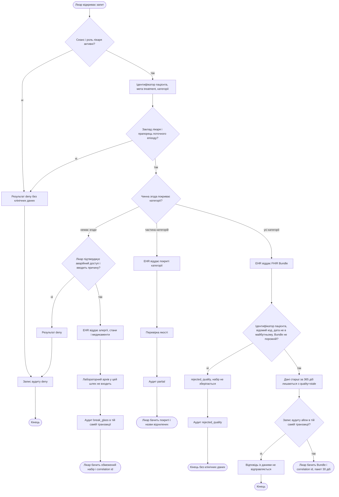

# Activity Diagram UC-04. Запросити дані для лікування

Задача PIS-14. Потік від входу лікаря до запису аудиту. Джерело кроків — специфікація UC-04.

Порядок перевірки збігається зі спільним правилом: збій автентифікації, ролі, згоди, якості або журналу зупиняє видачу. Окремого тихого шляху немає.

Часткова видача і аварійний доступ проходять ту саму перевірку якості і той самий запис аудиту в одній транзакції, що й повний Bundle. На схемі гілку `rejected_quality` розгорнуто на повному шляху, щоб не малювати три однакові відмови. Лабораторний архів в аварійний шлях не входить: це правило UC-04 AC2. Розбіжність із PIS-15 A-07 винесена в аркуш вичитки, а не знята цією діаграмою.