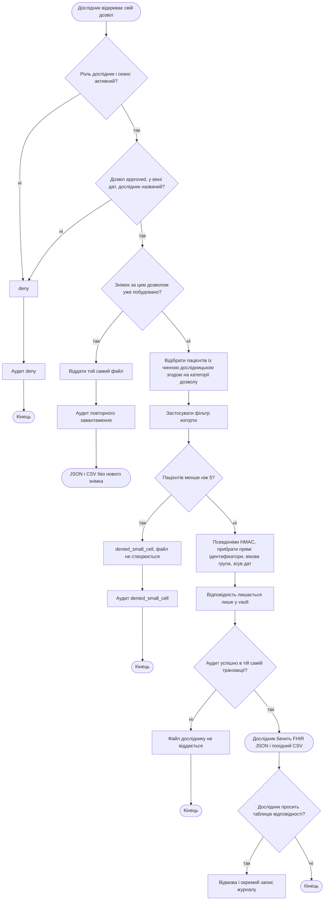

# Activity Diagram UC-06. Отримати дослідницький знімок

Задача PIS-20. Потік дослідника від відкриття дозволу до журналу. Ідентифікованих даних у відповіді немає.

CSV не є другим джерелом правди. Повторний знімок потребує нового дозволу. Строк дозволу не довший за 90 діб.