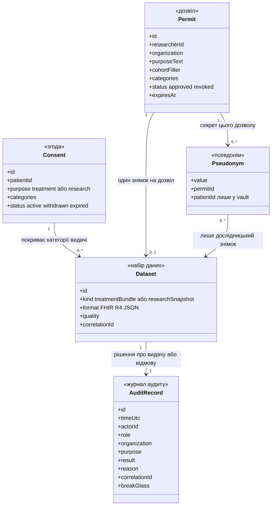

# Class Diagram

Задача PIS-24. Статична структура обміну: згода, дозвіл, набір даних, журнал аудиту, псевдонім. Це сутності, які методичка вимагає показати на класах для власної теми, не приклад ER з методички.

Звірив із UC-02, UC-04, UC-05, UC-06 і UC-08 у розділі 8 формалізації, з матрицею RBAC/ABAC, зі словником FHIR і з `nfr.md`. Політика доступу для лікування — згода. Політика доступу для дослідження — дозвіл DG разом зі згодою. Окремого класу «політика» не заводив: інакше з’явилася б сутність, якої немає ні в задачі, ні в прецедентах.

## Що означають зв’язки

- Згода окремо на лікування і окремо на дослідження. Одна не замінює іншу. Категорії: алергії, стани, ліки, спостереження. Лікувальна згода втрачає чинність через 180 діб. Відкликання зупиняє нові видачі і не видаляє журнал.
- Дозвіл видає DG. Строк не довший за 90 діб. На один дозвіл припадає не більше одного знімка. Повторне завантаження віддає той самий файл.
- Набір даних лікування — ідентифікований FHIR R4 Bundle. Набір даних дослідження — псевдонімізований FHIR JSON і похідний CSV. CSV не є другим джерелом правди. Успішний пакет лікаря доступний 30 діб. Знімок живе до кінця дозволу.
- Кожна видача і кожна відмова має рядок журналу. Поля ті самі, що в розділі 8.5: час UTC, користувач, роль, заклад, дія, мета, посилання на пацієнта або знімок, типи ресурсів, згода, дозвіл, результат, причина, correlation id, ознака аварійного доступу. Оновлення і видалення рядка журналу роль застосунку не має.
- Псевдонім рахується як HMAC-SHA256 від ідентифікатора пацієнта і секрету конкретного дозволу. У відповідь досліднику йдуть перші 32 шістнадцяткові символи, як у розділі 8.5. Сам Patient.id, секрет і зв’язок псевдонім–пацієнт лежать у схемі `vault`, не в наборі, який бачить дослідник.

Якість набору (`rejected_quality`, `quality=stale`) лишається атрибутом набору даних, не окремим класом. Порожній Bundle, невідомий код, дата в майбутньому і відсутній ідентифікатор пацієнта набір не зберігають.

## Що навмисно не закрито

- A-07 віддає лікарю в аварійному доступі також Observation. UC-04 AC2 у цей шлях лабораторний архів не пускає. На класах окремого набору «аварійний» немає, тож діаграма жодну з двох версій не обирає.
- Словник FHIR кладе код `managingOrganization` у дослідницький знімок. Розділ 2.2 формалізації прибирає ідентифікатор закладу зі знімка. У класі набору даних цього поля немає навмисно.
- PIS-17 ставить 500 мс на лікування і 2 с на знімок. Чернетка розділу 8.4 ставить стелю 3 с на запит лікування. Час до класів не входить.
- Activity UC-06 каже «зсув дат», розділ 8.5 — стале зміщення ±7 діб лише у `vault`, словник FHIR для клінічних дат знімка пише місяць і рік. Клас псевдоніма спосіб узагальнення дат не фіксує.
- A-17 не дає жодній ролі читати секрет HMAC. Клас K5 у розділі 8.5 віддає DG таблицю відповідності, секрет і зміщення дат. Псевдонім на діаграмі лежить у `vault`. Хто з ролей його читає, клас не вирішує.
