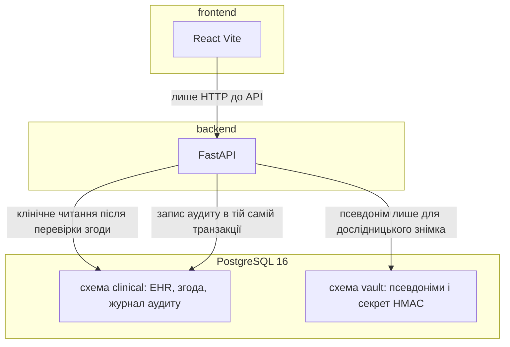
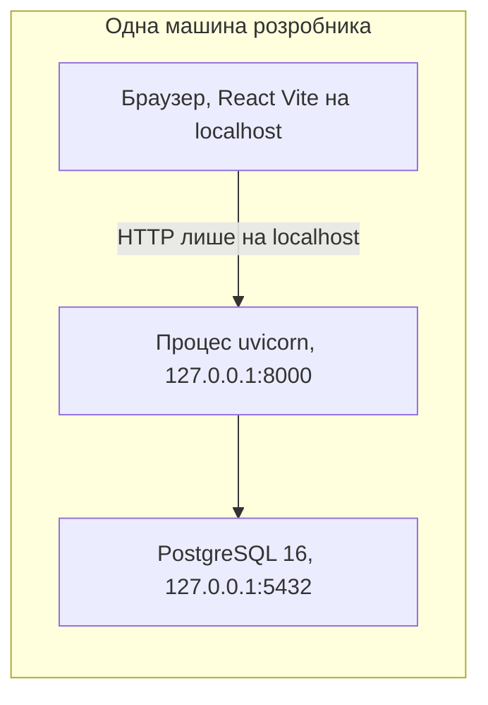

# Component і Deployment

Задача PIS-27. Локальний прототип: backend, frontend, PostgreSQL. Це не контур PIS-19. Там були логічні частини обміну без вузла розгортання. Тут ті самі частини сідають на три процеси однієї машини.

Стек беру з D8 і з `nfr.md`: FastAPI, PostgreSQL 16, React (Vite). Один локальний екземпляр. Окремої відмовостійкої схеми немає. Хмари, НСЗУ і КЕП немає.

## Компоненти

UI не з’єднаний ні з PostgreSQL, ні зі схемою `vault`. Лікар, пацієнт, дослідник і DG ходять у свої екрани, але всі екрани — один frontend і один API. Макет екранів і Figma тут не обираю: їх немає в матеріалах.

EHR у прототипі — таблиці схеми `clinical` і заздалегідь завантажений FHIR Bundle, не живе підключення до лікарняної системи. Згода і журнал аудиту лежать у тій самій схемі, щоб рішення про видачу і рядок журналу були однією транзакцією. Псевдонім і секрет HMAC лежать у `vault`. Роль застосунку, якою відкривається знімок дослідника, `vault` не читає.

## Розгортання

На `localhost` допускається HTTP. Будь-яке розгортання поза машиною команди — лише з TLS. Рядок підключення і секрет псевдонімізації беруться з `.env`. У Git лежить лише `.env.example`.

Якщо PostgreSQL недоступна, API обмін зупиняє. Окремого шляху повз журнал немає. Якщо `INSERT` аудиту в тій самій транзакції не пройшов, клінічний Bundle і дослідницький файл не віддаються.

Коду сервера і фронтенда в цьому файлі немає. Порти і схеми — контракт для PIS-31 і PIS-34.

## Що навмисно не закрито

- A-07 проти UC-04 AC2 не змінює розгортання: і алергії, і лабораторії, якщо їх колись включать в аварійний шлях, читаються з тієї самої схеми `clinical`.
- Код організації в дослідницькому знімку і спосіб узагальнення дат не вибирають, у якій схемі лежатиме поле. Відповідність і величина зміщення, якщо вона є, лишаються у `vault`.
- 500 мс, 2 с і стеля 3 с — пороги відповіді API на цій машині. Діаграма не обирає, яке число лишається вимогою.
- A-17 закриває секрет HMAC для кожної ролі. Клас K5 віддає його DG з окремим аудитом. Компонент `vault` є. Хто з ролей отримує читання, тут не вирішую.
