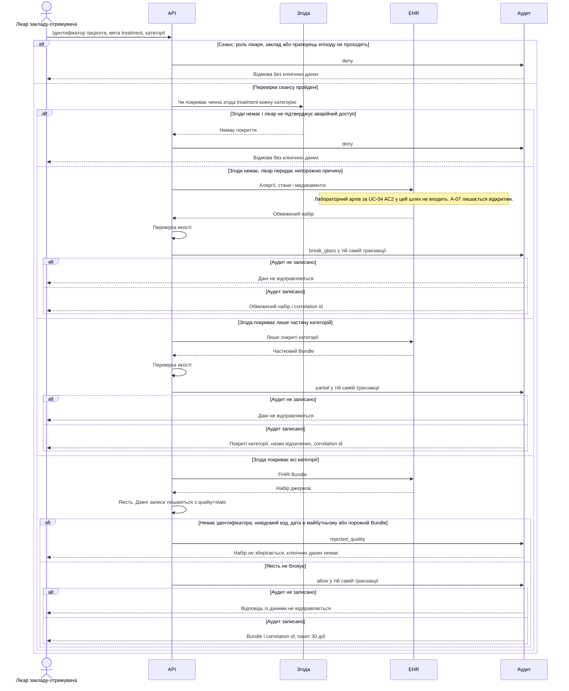

# Sequence для лікування

Задача PIS-25. Обмін лікаря: API, згода, EHR, аудит. Це UC-04, не дослідницький знімок.

Потік звірено з `docs/03-architecture/uml/activity-uc-04.md` і зі специфікацією UC-04. Учасники в описі задачі — лікар, API, згода, EHR, аудит. Перевірка якості лишається кроком API, бо окремого учасника для неї задача не називає. EHR закладу-джерела лікар сам не відкриває: дані забирає API після перевірки прав.

## Що повторює UC-04 і activity

- Лікар — лікар закладу-отримувача. Лікаря закладу-джерела на схемі немає.
- Немає активного сеансу, ролі лікаря, закладу або прапорця поточного епізоду — `deny`. Клінічного тіла у відповіді немає.
- Чинна згода перевіряється до читання EHR. Часткове покриття дає `partial`: покриті категорії віддаються, відхилені називаються.
- Аварійний доступ малюю як UC-04 AC2 і activity UC-04: алергії, стани, медикаменти, позначка `break_glass`, подія видима пацієнту. Лабораторний архів у намальований шлях не входить.
- Повна згода веде до FHIR R4 Bundle. Записи старші за 365 діб лишаються в наборі з `quality=stale`. Блокувальна якість дає `rejected_quality`, і набір не зберігається як клінічні дані закладу-отримувача.
- Журнал і рішення про видачу — одна транзакція. Якщо рядок аудиту не записано, дані не відправляються. Якщо PostgreSQL недоступна, API обмін зупиняє і журнал не обходить. Це правило `nfr.md`, на схемі воно те саме, що гілка «аудит не записано».
- Успішний пакет лікар бачить 30 діб разом із correlation id.

Стек, на якому це має виконатися: FastAPI, PostgreSQL 16, React (Vite). Ця діаграма код не додає.

## Що навмисно не закрито

- A-07 у матриці доступу віддає в аварійному доступі також Observation. UC-04 AC2 і activity UC-04 лабораторний архів у цей шлях не пускають. На схемі стоїть шлях AC2. A-07 я не викреслюю і не підміняю окремим кроком.
- Код організації в дослідницькому знімку, зсув дат і секрет HMAC цього sequence не стосуються. Їх не вирішую тут.
- PIS-17 ставить 500 мс на лікування. Чернетка розділу 8.4 ставить стелю 3 с на Bundle до 50 ресурсів. Схема час не обирає. Обидва числа лишаються в `nfr.md`.
