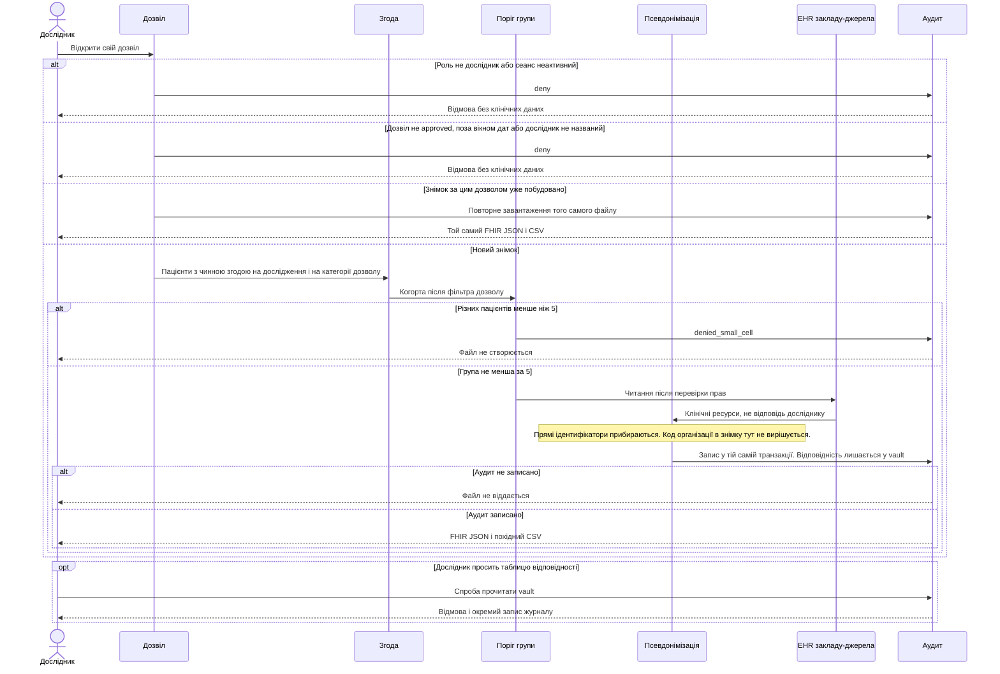

# Sequence для дослідження

Задача PIS-26. Обмін дослідника: дозвіл, псевдонімізація, поріг групи, аудит. Це UC-06, не лікувальний обмін і не аварійний доступ.

Потік звірено з `docs/03-architecture/uml/activity-uc-06.md` і з прецедентом UC-06 у розділі 8 формалізації. Учасники в описі задачі — дослідник, дозвіл, псевдонімізація, поріг групи, аудит. Згода стоїть окремо, бо activity UC-06 відбирає когорту за чинною дослідницькою згодою. EHR закладу-джерела стоїть окремо, бо `docs/03-architecture/uml/use-case-diagram.md` з’єднує з ним UC-06 після перевірки прав. Дослідник до EHR сам не ходить і ідентифікованого Bundle не бачить. Activity UC-06 окремої стрілки до EHR не малює: читання на цій схемі йде після дозволу, згоди і порога, а не замість них.

## Що повторює activity UC-06

- Немає ролі дослідника або активного сеансу — `deny` і запис аудиту. Клінічного тіла у відповіді немає.
- Дозвіл має бути `approved`, у вікні дат, і дослідник у ньому названий. Інакше той самий `deny`. UC-06 крок 2 ще перевіряє організації дозволу. Це перевірка дозволу, не рішення, чи класти код закладу в знімок.
- Якщо знімок за цим дозволом уже є, віддається той самий файл. Новий знімок не рахується. У журнал пишеться повторне завантаження. Новий знімок потребує нового дозволу. Строк дозволу не довший за 90 діб.
- У когорту входять лише пацієнти з чинною дослідницькою згодою на категорії дозволу. Далі застосовується фільтр когорти.
- Менше ніж 5 різних пацієнтів — `denied_small_cell`. Файл не створюється. Подія є в журналі.
- Інакше будуються псевдоніми, прибираються прямі ідентифікатори, дата народження замінюється віковою групою, дати узагальнюються. Відповідність псевдоніма і пацієнта лишається у `vault`. Дослідник її не отримує.
- Якщо рядок аудиту в тій самій транзакції не записано, файл не віддається.
- Якщо записано, дослідник бачить FHIR JSON і похідний CSV. CSV не є другим джерелом правди.
- Запит таблиці відповідності — відмова і окремий запис журналу. Це EX3 UC-06. Дослідник `vault` не отримує.
- Секрет HMAC. A-17 не дає читати його жодній ролі. Клас K5 у розділі 8.5 віддає таблицю відповідності, секрет і зміщення дат DG-адміністратору, і кожне таке читання пише журнал. Хто саме з цього списку доходить до DG, ця діаграма не обирає. На схемі є лише відмова досліднику.

Стек, на якому це має виконатися, уже записаний: FastAPI, PostgreSQL 16, React (Vite). Ця діаграма код не додає.

## Що навмисно не закрито

Ці розбіжності вже стоять у вичитці й на діаграмі прецедентів. Тут вони не знімаються.

- Код організації в дослідницькому знімку. Розділ 2.2 формалізації прибирає ідентифікатор закладу зі знімка. Словник FHIR кладе в знімок код `managingOrganization`. Крок псевдонімізації прибирає прямі ідентифікатори і не обирає, чи лишається код закладу.
- Узагальнення дат. Activity UC-06 каже «зсув дат», розділ 8.5 — стале зміщення в межах ±7 діб, величина лише у `vault`. Словник FHIR для клінічних дат знімка пише місяць і рік. На схемі стоїть узагальнення дат, без вибору одного способу.
- Вікова група на схемі є, як у activity UC-06. Ширину групи в 5 років фіксує розділ 2.2 і розділ 8.5. Словник іншої ширини не задає, тому окремої суперечки тут немає.
- A-07 і лабораторії UC-04. Це лікувальний аварійний шлях, не цей sequence. Діаграма його не малює і не вирішує, чи входить Observation в аварійний доступ.
- 500 мс і 2 с проти стелі 3 с. PIS-17 дає 2 с на дослідницький знімок і 500 мс на лікування. Чернетка розділу 8.4 дає 3 с на запит лікування. Ця схема час не обирає.
