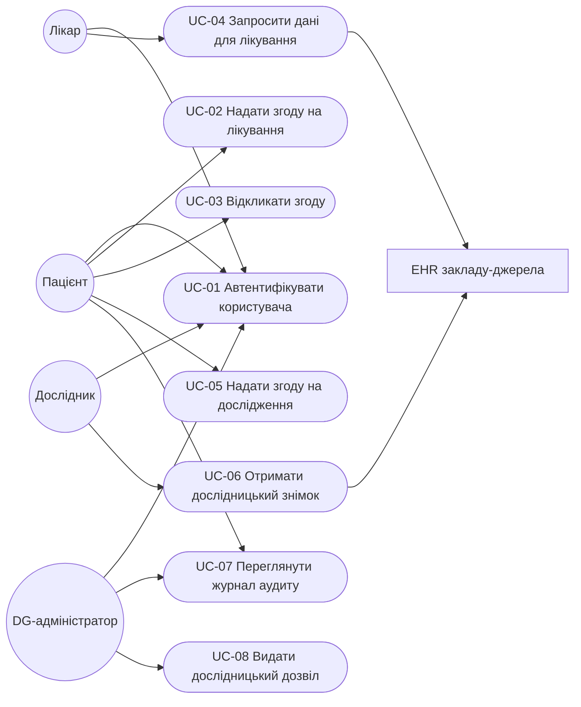

# Чистова Use Case Diagram

Задача PIS-23. Замінює чорнову діаграму з формалізації етапу 1. Набір прецедентів той самий: UC-01…UC-08. Аварійний доступ не є окремим прецедентом.

Що змінено відносно чорнової: діаграму винесено в окремий файл архітектури і підписано як чистову. Склад акторів і зв’язків не розширено. UC-04 як і раніше включає перевірку згоди, якості й аудиту. UC-06 включає псевдонімізацію, поріг групи і аудит. UC-03 відкликає обидві згоди за вибором пацієнта.

Адміністратор закладу на діаграмі відсутній навмисно: у прототипі він не має екрана.