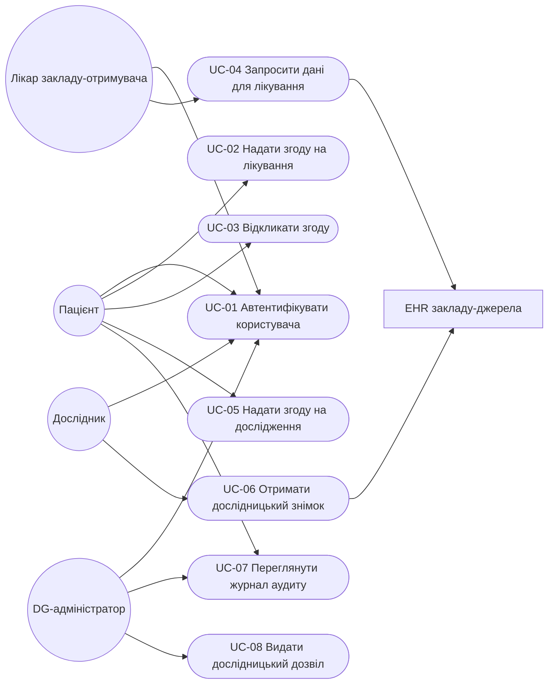
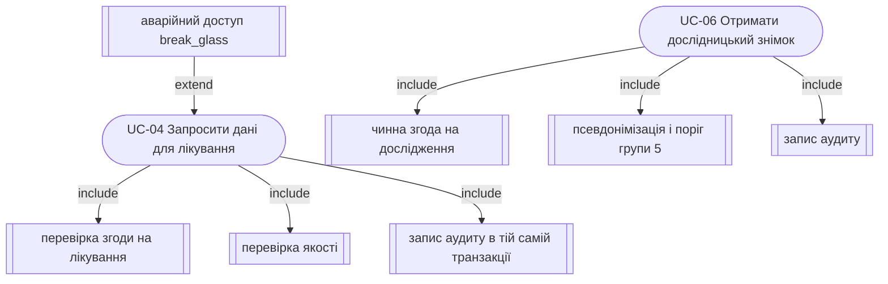

# Чистова Use Case Diagram

Задача PIS-23. Замінює чорнову діаграму з розділу 8 формалізації етапу 1. Набір прецедентів той самий: UC-01…UC-08. Нового прецеденту немає.

Актори й зв’язки звірені з `docs/01-requirements/uc-01-08-review.md` і зі специфікаціями розділу 8. Файл `docs/01-requirements/actors-and-use-cases.md` на `main` лишається каркасом розділу 6: цю діаграму він не замінює. Потоки UC-04 і UC-06 уже є в `docs/03-architecture/uml/activity-uc-04.md` і `activity-uc-06.md`. Тут їх не повторюю.

## Актори і прецеденти

| Актор | Прецеденти |
| --- | --- |
| Пацієнт | UC-01, UC-02, UC-03, UC-05, UC-07 лише свої події |
| Лікар закладу-отримувача | UC-01, UC-04 |
| Дослідник | UC-01, UC-06 |
| DG-адміністратор | UC-01, UC-07 увесь журнал, UC-08 |
| EHR закладу-джерела | зовнішня система для UC-04 і UC-06, після перевірки прав |

Лікаря закладу-джерела окремим актором немає: дані забирає платформа. Адміністратор закладу на діаграмі відсутній навмисно: у прототипі він не має екрана, облікові записи вже в початкових даних.

## Include і extend

Окремих прецедентів для цих кроків немає. Вони входять у UC-04 і UC-06 або розширюють UC-04.

UC-03 відкликає і лікувальну, і дослідницьку згоду: пацієнт обирає, яку саме. UC-02 і UC-05 лишаються двома окремими наданнями згоди. UC-08 видає дослідницький дозвіл; без нього UC-06 дані не віддає.

## Що змінено відносно чорнової

Чорнова в розділі 8 і рання копія в окремому файлі мали ті самі вісім прецедентів, але лікаря підписували просто «Лікар», а include і extend були лише в тексті. Тут лікар підписаний як лікар закладу-отримувача, зв’язки зведені в таблицю за вичиткою, а включення згоди, якості, аудиту, псевдонімізації і розширення аварійним доступом показано на схемі.

## Що діаграма не знімає

- A-07 у матриці доступу віддає в аварійному доступі також Observation. UC-04 AC2 лабораторний архів у цей шлях не пускає. На схемі аварійний доступ лишається extend UC-04, без окремого прецеденту і без вибору однієї з цих двох версій.
- Словник FHIR кладе код організації в дослідницький знімок. Розділ 2.2 формалізації прибирає ідентифікатор закладу зі знімка. UC-06 цього не переозначує.
- Поріг 500 мс і 2 с проти стелі 3 с до діаграми прецедентів не входить.
